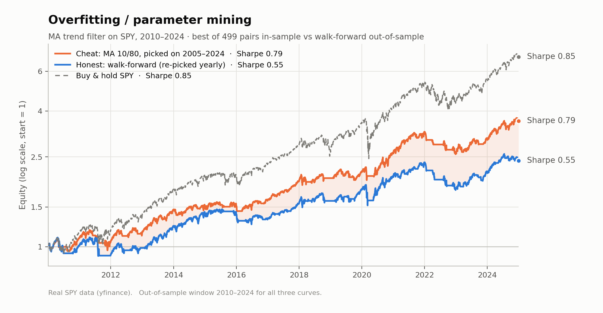

# Backtest Pitfalls — how a few bugs manufacture a beautiful (and fake) equity curve

> **How big a bias is has nothing to do with how easy it is to catch. The dangerous ones are the
> 0.15–0.25 Sharpe gaps: exactly the difference between "mediocre" and "investable", and small
> enough that nothing gives them away.**

Three classic backtesting mistakes, each reproduced on one minimal engine as
*cheat → reveal the bug → honest re-run* of the same strategy:

| Pitfall | What leaks from the future | Sharpe, cheat → honest | Gap |
|---|---|---|---|
| **Look-ahead bias** (time) | the return of the day being traded | 13.64 → −0.36 | −14.00 |
| **Survivorship bias** (cross-section) | which companies will survive | 0.36 → 0.21 | −0.15 |
| **Overfitting** (parameters) | which parameters will turn out best | 0.79 → 0.55 | −0.25 |

The first gap is so large it gets caught immediately. The other two look credible.
The full argument, with charts, is in **[docs/writeup.md](docs/writeup.md)**.



## How to read this project

1. **[docs/writeup.md](docs/writeup.md)**: the argument, with one chart and the key numbers per pitfall.
2. **The notebooks, in order.** Each one is *cheat → reveal → fix* with the full working:
   [02_lookahead](notebooks/02_lookahead.ipynb) →
   [03_survivorship](notebooks/03_survivorship.ipynb) →
   [04_overfitting](notebooks/04_overfitting.ipynb) →
   [05_summary](notebooks/05_summary.ipynb).
3. **`src/`** if you want to see how it's built. Start with `backtest.py`; it's about 100 lines.

**Data:** look-ahead and overfitting use real SPY prices (yfinance, cached in `data/`).
Survivorship uses a seeded synthetic universe, because free data doesn't keep the
companies that died.

## Reproduce

```bash
pip install -r requirements.txt && python run_all.py
```

Use **Python 3.12** (see the note at the top of `requirements.txt`). `run_all.py`:
- loads the data;
- re-executes all notebooks;
- re-exports `figures/`;
- prints the summary table;
- recomputes all 64 numbers quoted in the write-up and checks each one against the text.

It exits non-zero if anything fails or disagrees. It takes a few minutes.

The cached prices in `data/` are part of the reproduction. Yahoo revises its
dividend-adjusted history over time, so `python run_all.py --refresh-data` may
move some numbers slightly. If it does, the check table shows which ones.

`streamlit run app.py` opens an interactive page that switches between the three pitfalls.

## Layout

```
backtest-pitfalls/
├── run_all.py         # one-command reproduction + write-up number check
├── app.py             # Streamlit page: switch between pitfalls
├── docs/writeup.md    # the write-up: phenomenon / cause / how to avoid, per pitfall
├── notebooks/         # 02 look-ahead · 03 survivorship · 04 overfitting · 05 summary
├── src/
│   ├── backtest.py    # minimal honest backtest engine (equity, Sharpe, drawdown, turnover)
│   ├── data.py        # load_prices / load_universe, parquet cache, synthetic fallback
│   ├── universe.py    # synthetic multi-stock universe with bankruptcies
│   ├── grid.py        # MA crossover signal + vectorised parameter grid
│   ├── pitfalls.py    # the three cheat-vs-honest comparisons + summary table
│   ├── plots.py       # shared chart style, light/dark themes, figure export
│   └── checks.py      # every number in the write-up, recomputed and compared
├── figures/           # exported before/after charts, light + dark
├── data/              # cached prices (parquet); keep for exact reproduction
└── requirements.txt   # pinned versions, Python 3.12
```

## The engine in one line

`position[t]` is the weight you decide at the **close of day t**; it earns the
return of **day t+1**. That single `.shift(1)` (the `lag` argument in
`run_backtest`) is what separates an honest backtest from a look-ahead-biased
one. `notebooks/02_lookahead.ipynb` shows what happens when you set `lag=0`.

## Progress

- [x] **Day 1** — repo skeleton, data layer with cache, minimal backtest engine.
- [x] **Day 2** — look-ahead bias notebook (`notebooks/02_lookahead.ipynb`).
- [x] **Day 3** — survivorship bias notebook (`notebooks/03_survivorship.ipynb`, synthetic universe in `src/universe.py`).
- [x] **Day 4** — overfitting / parameter mining notebook (`notebooks/04_overfitting.ipynb`, MA grid in `src/grid.py`).
- [x] **Day 5** — unified before/after charts + summary table (`notebooks/05_summary.ipynb`, `figures/`) and Streamlit page (`app.py`).
- [x] **Day 6** — write-up per pitfall (`docs/writeup.md`), README opening tightened.
- [x] **Day 7** — one-command reproduction (`run_all.py`) with write-up number check, pinned requirements, code clean-up.
