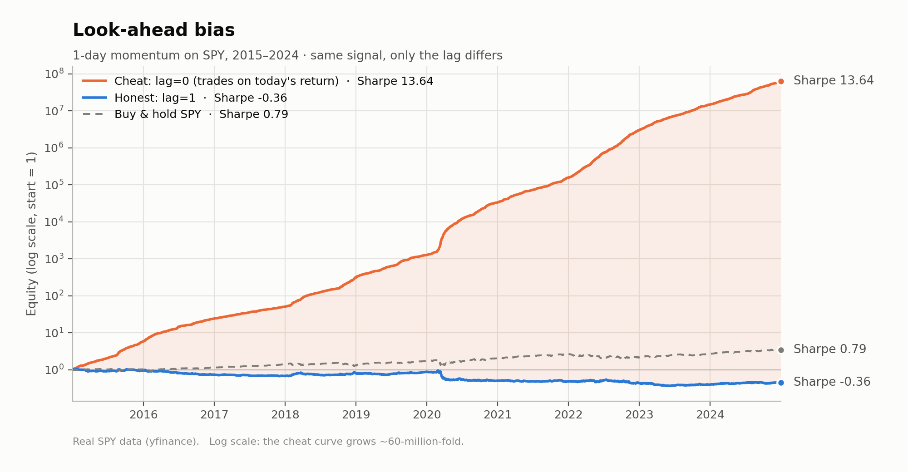
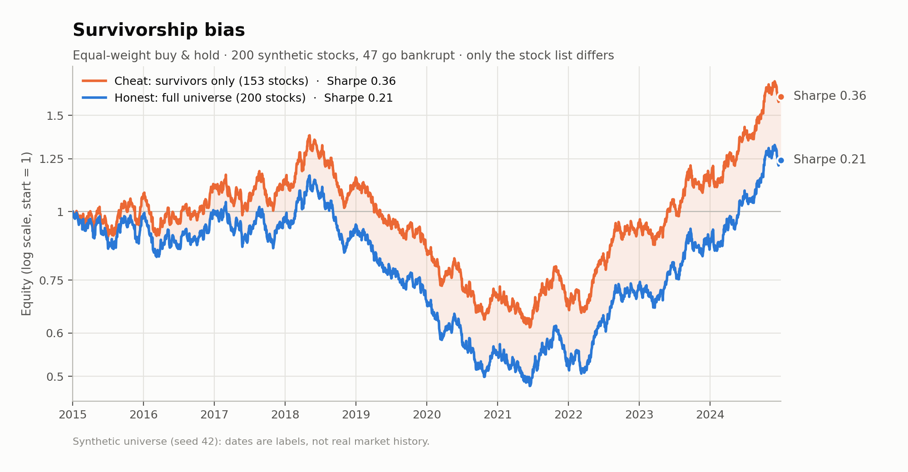
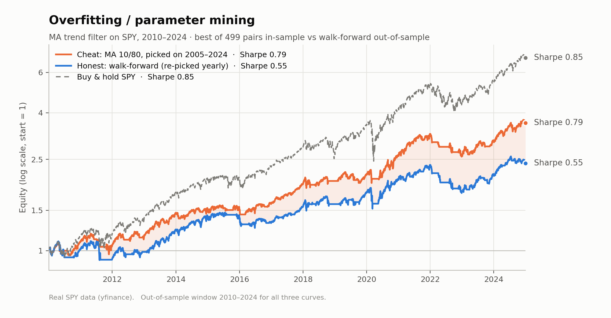

# Backtest Pitfalls — write-up

> **How big a bias is has nothing to do with how easy it is to catch. The dangerous ones are the
> 0.15–0.25 Sharpe gaps: exactly the difference between "mediocre" and "investable", and small
> enough that nothing gives them away.**

This project reproduces three classic backtesting mistakes on one minimal engine
(`src/backtest.py`) and measures each one the same way: run a *cheat* version, find the bug, run
the *honest* version of the same strategy, and compare. The summary from
`notebooks/05_summary.ipynb`:

| Pitfall | Sharpe, cheat | Sharpe, honest | Gap |
|---|---|---|---|
| Look-ahead bias | 13.64 | −0.36 | **−14.00** |
| Survivorship bias | 0.36 | 0.21 | **−0.15** |
| Overfitting / parameter mining | 0.79 | 0.55 | **−0.25** |

The first gap is enormous, and nobody would believe the number, so it gets caught. The other two
are about a hundred times smaller, and they're the ones that end up in real decisions.

All three charts below use the same conventions: **orange** is the cheat, **blue** is the honest
version, **dashed grey** is buy-and-hold SPY where there is a natural benchmark, and the shaded
area is the part of the result that exists only because of the bug.

---

## 1. Look-ahead bias — the time dimension

*Notebook: `notebooks/02_lookahead.ipynb` · data: SPY, 2015–2024, real (yfinance) · 1 bp costs*

### Phenomenon

A one-day momentum rule: at each close, go long SPY if it rose today and short if it fell. Over
2015–2024 the backtest reports:

| | Sharpe | CAGR | Max drawdown |
|---|---|---|---|
| Cheat (`lag=0`) | **13.64** | 504.3% | −0.02% |
| Buy & hold SPY | 0.79 | 13.1% | −33.7% |

$1 grows to about $63 million in ten years. The maximum drawdown through COVID and 2022 is
essentially zero, and the only losses come from transaction costs.



### Cause

The engine has one contract: **`position[t]` is decided at the close of day *t* and earns the
return of day *t+1*.** That's enforced by a single line in `run_backtest`:

```python
effective_pos = position.shift(lag).fillna(0.0)
gross = effective_pos * asset_ret
```

With `lag=0` the shift disappears, so the position decided at the close of day *t* is
multiplied by the return of day *t*. That's the return the signal was computed from, and it's
already over by the time you could trade. For this signal the result collapses to an identity:

$$\text{strategy return}_t = \operatorname{sign}(r_t)\cdot r_t = |r_t|$$

The notebook checks this directly (`np.allclose(gross, |ret|)` → `True`). The strategy is paid
the absolute value of every day's move. It is right on every single day, including the −10.94%
day of 16 March 2020.

The signal itself is legitimate: it uses only prices up to today's close. The bug is entirely in
*when it gets paid*. With `lag=1`, the same signal gives:

| | Sharpe | CAGR | Max drawdown |
|---|---|---|---|
| Honest (`lag=1`) | **−0.36** | −7.6% | −65.2% |

### How to avoid it

- **Make the timing a single, explicit, tested line.** In this engine it's `position.shift(lag)`.
  The question to ask of every input: *at the moment this position is taken, could I have known it?*
- **Watch for the disguised forms.** Look-ahead rarely appears as a literal `lag=0`. It shows up as:
  - a signal and a return computed from the same DataFrame row;
  - a rolling indicator with no `.shift(1)` after it;
  - features normalised with the full-sample mean and standard deviation;
  - data stamped with the period it *describes* rather than the date it was *published*
    (earnings, macro releases, index membership).
- **Treat implausible results as bugs.** A double-digit Sharpe or a decade without drawdown
  should start an audit, not a celebration.
- **On real data**, the hard part is publication timestamps. Fundamentals and economic data get
  revised, and free sources usually store only the final revised value on the period-end date.
  Getting point-in-time "as first reported" values needs vendor data that keeps the history of
  revisions.

> **Interview point.** The honest strategy *loses* money (Sharpe −0.36), and that's expected.
> The experiment shows a **timing bias**. It says nothing about whether momentum has alpha: a
> strategy with no edge, paid with information it shouldn't have, looks like a money machine.
> SPY shows no useful one-day momentum, so once the leak is closed the strategy just pays costs
> on daily flips. Getting a loss after the fix is a sign the fix worked.

---

## 2. Survivorship bias — the cross-sectional dimension

*Notebook: `notebooks/03_survivorship.ipynb` · data: synthetic universe of 200 stocks, seed 42
(`src/universe.py`) · dates are labels, not real market history*

### Phenomenon

An equal-weight buy-and-hold portfolio, bought on day one and never traded. Built from "the stocks
that exist today", it reports a respectable decade:

| | Sharpe | CAGR | Max drawdown | Final value of $1 |
|---|---|---|---|---|
| Cheat: survivors only (153 stocks) | **0.36** | 4.78% | −55.4% | 1.62 |

Unlike the look-ahead cheat, this curve is completely believable. That's what makes it dangerous.



### Cause

Free data mostly lacks the histories of companies that no longer exist, so a synthetic universe
is the only way to know the full truth. In this one, 200 stocks start at the same price, and
**47 of them (24%) go bankrupt** during the sample: a stock is delisted the first day it closes
below 10% of its starting price, and shareholders get nothing.

The cheat portfolio is formed in January 2015, but its stock list was drawn up at the **end** of
the sample: the 153 still trading. The "bug" is one step before the backtest runs:

```python
equal_weight_buy_and_hold(uni.prices[uni.survivors])   # cheat: the list is chosen with hindsight
equal_weight_buy_and_hold(uni.prices)                  # honest: everything listed on day one
```

Including every stock that was investable on day one gives:

| | Sharpe | CAGR | Max drawdown | Final value of $1 |
|---|---|---|---|---|
| Honest: full universe (200 stocks) | **0.21** | 2.11% | −58.8% | 1.24 |

CAGR falls by more than half. Because the data is synthetic, we can check *why* against the true
parameters each stock was simulated with:

| | true alpha | beta | idiosyncratic vol |
|---|---|---|---|
| Delisted | −1.12% | 1.03 | 43.7% |
| Survived | +0.18% | 1.00 | 35.9% |

Survival is not random. The survivors are the stocks with better true alpha and lower risk, so a
survivors-only sample misrepresents what was actually available to buy. Bankruptcies also cluster:
17 of the 47 happen in 2020, during the synthetic market's slump, so the survivors-only backtest is
most wrong during the crisis.

To check that seed 42 isn't a fluke, the experiment was rerun on 100 independently generated
universes. The survivors-only CAGR is higher in **all 100**, by a mean of 1.52 pp/yr (median 1.37,
range 0.28–4.53). Seed 42 is on the high side: 24% of its stocks delist, against an average of
13.6%.

### How to avoid it

- **Define the universe as it was known on each date.** That means point-in-time membership, not
  today's list run backwards.
- **Keep dead companies in the data,** with their final prices and delisting returns.
- **On real data this is mostly a data-access problem:**
  - `yfinance` is keyed by *current* tickers. Delisted companies usually return nothing, and
    tickers get reused by unrelated companies.
  - Today's S&P 500 list is a survivors list, and it also selects companies that *later* grew
    large enough to join the index.
  - **CRSP** (via WRDS, usually through a university) is the academic standard: dead stocks,
    permanent identifiers, delisting returns. Even CRSP had gaps here. Shumway (1997, *Journal of
    Finance*) showed that missing delisting returns bias results upward.
  - Commercial vendors (e.g. Norgate Data, Sharadar, Compustat) sell survivorship-free data, and
    the price is part of the lesson.
  - A free approximation: Wikipedia's S&P 500 page has a dated table of additions and removals.
    Walking it backwards from today rebuilds approximate historical membership. You still need
    prices for the removed names, which brings you back to the first problem.

> **Interview point.** Most of the gap comes from **selection**, not from the bankruptcy losses.
> If delisted shareholders are assumed to get 0%, 50% or even 100% of the last price, the
> survivors-minus-full CAGR gap is 2.68, 2.58 and 2.49 pp/yr: it barely moves. So you can't fix
> survivorship bias by assuming a reasonable delisting haircut. The survivors are a biased sample
> of luck and quality, and only putting the dead stocks back in removes the bias.

---

## 3. Overfitting / parameter mining — the parameter dimension

*Notebook: `notebooks/04_overfitting.ipynb` · data: SPY, 2005–2024, real (yfinance) · 1 bp costs*

### Phenomenon

A moving-average trend filter: hold SPY when the fast average is above the slow one, otherwise hold
cash. Search fast ∈ {5…100} × slow ∈ {20…300}, which gives **499 pairs**. The best pair on
2005–2024, MA 10/80, reports:

| | Sharpe | CAGR | Max drawdown |
|---|---|---|---|
| Cheat: MA 10/80, chosen on 2005–2024 | **0.82** | 9.0% | **−20.4%** |
| Buy & hold SPY | 0.61 | 10.3% | −55.2% |

The pitch: a Sharpe about a third higher than the index, with the drawdown cut from −55% to −20%
by sidestepping 2008 and the 2020 crash. Nothing about the strategy looks broken.



### Cause

Every backtest in the grid is honest: `lag=1`, real data, costs. The bias comes from the
**selection step**:

```python
best_full = full_grid.stack().idxmax()   # chosen by looking at 2005–2024 ...
run_backtest(px, ma_crossover(px, *best_full), ...)   # ... and reported on 2005–2024
```

The 0.82 is not the result of one experiment. It is the **maximum of 499 experiments**, chosen
with knowledge of how every pair did over the same 20 years it is reported on. Future
information leaks into the *parameters* this time, not into the signal. Two tests show it:

**Out of sample.** Search on 2005–2014 only. The winner is MA 45/160 with a Sharpe of 0.96. On
2015–2024 its Sharpe drops to 0.71, below buy-and-hold's 0.79 over the same years. A
**walk-forward** test repeats the honest procedure 15 times: each year, pick the best pair from
the previous five years and trade it for one year. On average the chosen pair has an in-sample
Sharpe of 1.10 and delivers 0.69 out of sample. Over the common window 2010–2024:

| | Sharpe | CAGR | Max drawdown |
|---|---|---|---|
| Cheat: MA 10/80, chosen in-sample | 0.79 | 9.0% | −20.4% |
| **Honest: walk-forward, out-of-sample** | **0.55** | 6.0% | −24.6% |
| Buy & hold SPY | 0.85 | 13.8% | −33.7% |

The long/short version of the strategy goes further: its full-sample best (45/160, Sharpe 0.51)
becomes **−0.09** in walk-forward. The edge changes sign.

**Multiple comparisons.** The winner beats the median pair by 0.15 Sharpe, while one 20-year Sharpe
estimate has a standard error of about 0.26. In a simulation where every strategy has zero true
skill, the best of 500 still shows an expected Sharpe of 0.68 over 20 years. A permutation test
shuffles SPY's daily returns, which removes any trend, and reruns the whole grid 200 times. A
"best pair" beats buy-and-hold by as much as MA 10/80 does in 15% of those trend-free histories
(p ≈ 0.15).

### How to avoid it

- **Keep a hold-out set and use it once.** Every time you look at the test results and go back to
  adjust, the test set becomes training data.
- **Test the procedure, not the parameter.** Walk-forward evaluates "choose the best recent
  parameters, then trade them", which is what you'd actually run live.
- **Count and report your trials.** A Sharpe of 0.8 after one try and after 500 tries are very
  different claims. The Deflated Sharpe Ratio (Bailey & López de Prado, 2014) adjusts for the
  number of trials. Harvey, Liu & Zhu (2016) argue that a new factor needs a t-statistic above
  about 3, not 2.
- **Use fewer parameters,** and prefer broad regions of parameters that work over sharp optima.
- **On real data,** the trial count you need to report includes everything you tried informally:
  earlier versions, other tickers, the idea you dropped after one look. Most of those aren't
  written down anywhere, which is why the true number of trials is usually underestimated.

> **Interview point.** Three findings, from simplest to most subtle:
>
> 1. **In-sample rank tells you nothing about out-of-sample rank.** Across all 499 pairs, the
>    correlation between 2005–2014 Sharpe and 2015–2024 Sharpe is **−0.04**. Picking the top of
>    the in-sample ranking is selecting on noise.
> 2. **A plateau protects you against a lucky *point*, not a lucky *period*.** In 2005–2014 the
>    heatmap shows exactly the kind of broad bright plateau you're told to look for (fast ≈
>    30–50, slow ≈ 120–230). In 2015–2024 that region is unremarkable, and the best pair moves to
>    5/130.
> 3. **The family may work. The claim that the best parameter is special can't be told apart from
>    luck.** Against the shuffled histories, the *median* pair beats buy-and-hold by +0.05 Sharpe
>    on real SPY versus −0.14 in a typical shuffle, so trend filtering as a family seems to do
>    something real (possibly by avoiding high-volatility crashes). The *winner's* extra edge has
>    p ≈ 0.15. The honest claim is "MA trend filters on SPY may reduce drawdowns". The overfit
>    claim is "MA 10/80 has a Sharpe of 0.82".

---

## Closing: one mistake in three dimensions

The three pitfalls are the same error made along three different dimensions of a backtest:

| Dimension | Pitfall | What leaks from the future | Where it enters |
|---|---|---|---|
| **Time** | Look-ahead bias | the return of the day being traded | `position.shift(lag)` with `lag=0` |
| **Cross-section** | Survivorship bias | which companies will still exist | the stock list passed to the backtest |
| **Parameters** | Overfitting | which parameters will turn out best | the `idxmax()` over the grid |

In each case, a decision inside the backtest uses information that wasn't available when the
decision would have been made. What differs is how visible the result is. The time-dimension leak
produces a Sharpe of 13.64, which nobody believes. The cross-sectional and parameter leaks produce
gaps of 0.15 and 0.25: a result that looks credible, a strategy that looks a bit better than it
is, and a decision made on it.

That's the point of the project: **how big a bias is has nothing to do with how easy it is to
catch.** The obvious bug is the cheap one. The expensive ones are the 0.15–0.25 Sharpe gaps that
separate "mediocre" from "investable", and that nothing exposes at the time you're looking at
the backtest.
